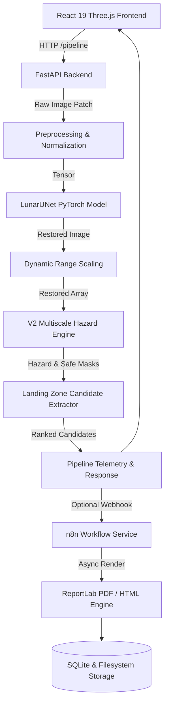

# System Architecture — Lunar PSR Terminal

## Modular Components
1. **Frontend (`frontend/`)**: Single-page application using Zustand for mission state and Three.js / React Three Fiber for 3D orbital-to-surface visualization.
2. **Backend (`backend/app/`)**: REST API exposing health endpoints, image inference, hazard masking, and report generation.
3. **ML Pipeline (`ml/src/`)**: PyTorch UNet implementation, loss functions, and evaluation metrics.
4. **Data Layer (`data/`)**: PDS4 raw calibration raster storage and high-resolution/low-resolution training pairs.
5. **Report Service (`backend/app/services/reports/`)**: SQLite durable state engine for background PDF/HTML export.
